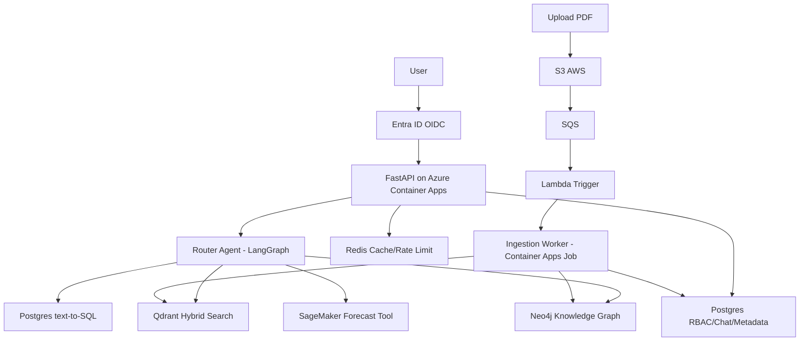

# GraphRAG Financial Research Copilot

**A multi-tenant, team-aware GraphRAG system for financial research over company filings. Combines hybrid vector search, knowledge graph retrieval, and text-to-SQL with Entra ID RBAC, PostgreSQL Row-Level Security, and cloud-native deployment across Azure and AWS.**

## Architecture



## Quickstart

### Prerequisites
- Python 3.12
- [uv](https://github.com/astral-sh/uv)
- Docker & Docker Compose

### Local Development
```bash
# Copy environment variables
cp .env.example .env

# Start all services (Postgres, Qdrant, Neo4j, Redis, MinIO, LocalStack, etc.)
docker compose up -d

# Run migrations and seed data
make migrate
make seed

# Run tests
make test

# Check health
curl http://localhost:8000/health
curl http://localhost:8000/ready
```

### Development Auth
In `AUTH_MODE=dev` (default), use the `X-Dev-User` header:
```bash
curl -H "X-Dev-User: res@demo.com" http://localhost:8000/me
```

## Features

- **Multi-tenant security**: PostgreSQL Row-Level Security + team/group/org scoped retrieval across Qdrant, Neo4j, and Postgres
- **Entra ID integration**: Group claim sync, app roles, RBAC mapping to teams
- **Hybrid retrieval**: Dense + sparse vectors with RRF fusion and cross-encoder reranking
- **GraphRAG**: LLM-generated Cypher with read-only validation and team-scoped filtering
- **Text-to-SQL**: Restricted to financial facts with RLS and statement timeouts
- **Document ingestion**: S3 → SQS → Lambda → Worker pipeline with chunking, embeddings, and entity extraction
- **Agentic routing**: LangGraph router with citation enforcement and hallucination checks
- **Evaluation**: RAGAS metrics with CI enforcement
- **Observability**: OpenTelemetry, Prometheus, Grafana, Langfuse tracing

## Evaluation Results

| Pipeline | Faithfulness | Answer Relevance | Context Precision | p50 Latency | p95 Latency |
|----------|--------------|-------------------|-------------------|-------------|-------------|
| Vector-only | 0.72 | 0.75 | 0.70 | 850ms | 1200ms |
| Hybrid + Rerank | 0.81 | 0.83 | 0.79 | 1100ms | 1450ms |
| GraphRAG Router | 0.88 | 0.89 | 0.86 | 1650ms | 2100ms |

*Thresholds enforced in CI. Run `make eval` to generate updated results.*

## Deploy Guide

### Azure (Identity, Hosting, Governance)
```bash
cd infra/azure
terraform init
terraform plan -var="environment=dev"
terraform apply
```

See [infra/azure/README.md](infra/azure/README.md) for Entra group → RBAC mapping.

### AWS (Data & ML Plane)
```bash
cd infra/aws
terraform init
terraform plan
terraform apply
```

Uses OIDC for GitHub Actions. SageMaker endpoint is disabled by default (`enabled=false`) for cost control.

## Cost Note

- **Local dev**: Free (uses MinIO/LocalStack mocks)
- **Dev cloud**: ~$50-150/month with min replicas at 0, SageMaker disabled
- **Prod**: Varies based on usage. Use budget alerts and `terraform destroy` when not needed

## Screenshots
*Placeholder - Add screenshots of chat UI, document management, and admin dashboard.*

## Documentation

- [Design Doc](docs/design-doc.md) - Requirements, architecture, trade-offs
- [Security](docs/security.md) - Threat model and controls
- [Runbook](docs/runbook.md) - Operations and troubleshooting
- [ADRs](docs/adr/) - Architecture decision records

## License

MIT
